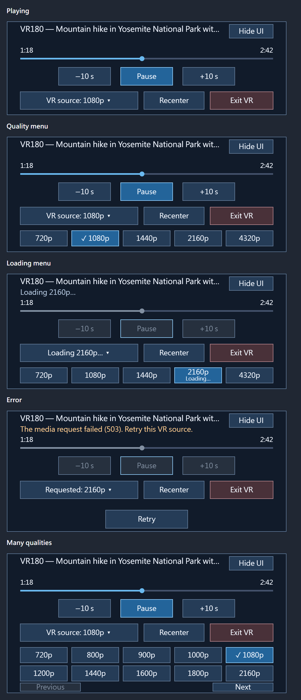
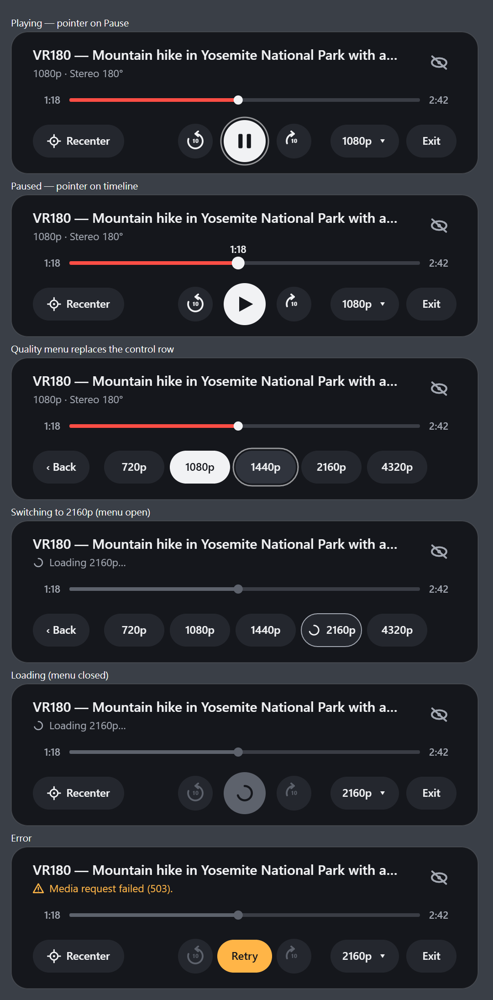

# Review of the UX implementation — round 2

Date: October 31, 2026
Scope: uncommitted working tree, with focus on the headset panel (`src/xr-ui.js`) and page UI (`src/main.js`), checked against [ux-design.md](ux-design.md).
Method: code reading, `npm test` (23/23 pass), `npm run test:panel` (current render below), and a rendered mock-up of a proposed visual design.

Decisions already made by the owner and not reopened here: Enter VR in YouTube's control bar, the in-VR panel and its controls, switching sources inside the session, and trigger-away hide/show with a **Hide UI** button.

## Verdict

Most functional UX issues from round 1 are fixed. What's left is a few state bugs and the visual design. The panel works but still looks like a debug form: square boxes, uniform navy fill, three stacked rows of mismatched widths, and labels where icons would read faster. §3 proposes a complete visual system that can be implemented inside the existing `paint()` without changing behavior.

## 1. Round-1 status

| Round-1 item | Status |
| --- | --- |
| Timeline doesn't read as a timeline | **Fixed.** Thin track, playhead, times at both ends. |
| Title and status lines misaligned | **Fixed.** Title is left-aligned. |
| Status repeats the quality button | **Fixed** during playback; it shows only while busy or in an error. |
| Permanent hint text | **Fixed.** Removed from the panel. |
| Quality menu doesn't mark the current quality | **Fixed.** ✓ on active, "Loading…" on pending. |
| Error hides the last quality | **Fixed.** Shows "Requested: 2160p". |
| No visual hierarchy | **Partly.** Pause is blue and Exit is red, but every other control is still the same box. |
| Panel not tilted toward the viewer | **Open.** `anchorMatrix` is unchanged. |
| Re-resolving all formats on every switch | **Fixed.** `StereoResolver` caches per video until signed URL expiry or 5 minutes. |
| Unthrottled MutationObserver and diagnostics | **Fixed.** 100 ms attach throttle, 500 ms diagnostics refresh. |
| Hard-coded version | **Fixed.** |
| Unsupported-browser reason only in a tooltip | **Fixed.** Also shown in Details. |
| Details popover overlaps YouTube's settings menu | **Open.** Still `right:16px; bottom:65px`. |
| Controller feedback overstated in notes | Not rechecked. |

## 2. Remaining defects in the current panel



1. **Disabled buttons keep their accent border.** `button()` applies `style.border` even when `disabled`, so a disabled Pause keeps a bright blue outline during loading and errors and looks focused (*Loading menu* and *Error* above). Disabled buttons should ignore the style overrides.
2. **"Loading 2160p…" appears three times:** in the status line, on the quality button and on the menu item. The two-line menu item is also cramped: a 20 px "Loading…" squeezed under the label in a 56 px button. One status line plus a spinner on the target item is enough.
3. **The panel changes height with state:** 344 → 423 (menu) → 444 (error) → 512 (many qualities). It grows downward from a fixed top, so the bottom edge moves toward the wearer's lap as they interact. A constant height is calmer, and §3 achieves it.
4. **The pager is too small.** With more than 10 qualities, Previous/Next are 30 px tall, about half the height of every other target, and sit against the bottom border. Most videos will never hit this case after the 720p minimum, but when it happens it looks broken.
5. **Retry gets its own row** below everything, far from the error message it answers.
6. **No mipmaps on the panel texture.** It's 1024 × 512 (power of two) with `LINEAR` filtering. Thin strokes and text shimmer when viewed at a slant or with head motion. Use `gl.generateMipmap` and `LINEAR_MIPMAP_LINEAR`, regenerating mipmaps after each upload. It's cheap at four uploads a second.
7. **Font stack is plain `sans-serif`.** On SteamOS that falls back to whatever is installed (often DejaVu Sans, which is wide). Use an explicit stack and weights; see §3.

## 3. Proposed visual design



Mock-up source: [review/xr-panel-proposal.html](review/xr-panel-proposal.html). It's plain Canvas 2D, the same API `paint()` already uses, so the drawing code ports almost directly.

### Composition

One compact card, **1024 × 312 canvas pixels** (1.28 × 0.39 m at the current scale), with **constant height in every state**:

```text
┌──────────────────────────────────────────────────────────────┐
│ Video title (semibold, ellipsized)                       (👁̸) │  header
│ 1080p · Stereo 180°   |  ◌ Loading 2160p…  |  ⚠ error text    │  status line
│                                                              │
│ 1:18 ━━━━━━━━━━━━━━━━━━━●──────────────────────────── 2:42   │  timeline
│                                                              │
│ (⌖ Recenter)        (↺10)  ( ❚❚ )  (10↻)      (1080p ▾) (Exit)│  control row
└──────────────────────────────────────────────────────────────┘
```

- **Three zones, not three rows of boxes:** header, timeline, and a single control row grouped left / center / right. Utility (Recenter) on the left, transport in the center, source and exit on the right. This is the layout people already know from video players.
- **The quality menu replaces the control row** (`‹ Back` plus one pill per quality) instead of growing the panel. Up to six fit; for more, page horizontally with the same 72 px pills, never a thinner row.
- **Errors also stay in place:** the status line turns amber with an icon, and the center play button becomes an amber **Retry** pill, right where the wearer is already looking.
- **Hide UI becomes an icon button** (eye with a slash) in the header corner. It's still a 76 px target.

### Color tokens

| Token | Value | Use |
| --- | --- | --- |
| `surface` | `#15171c` | Panel background |
| `raised` | `#24272e` | Button fill |
| `hover` | `#30343d` | Hovered button fill |
| `line` | `rgba(255,255,255,.10)` | Panel border |
| `text` | `#f1f2f4` | Primary text, playhead, play button fill |
| `sub` | `#a3a8b2` | Secondary text, times, icons in the header |
| `dim` | `#5d626c` | Disabled icons and fills |
| `accent` | `#ff4e45` | Played portion of the timeline only |
| `track` | `#3a3d45` | Unplayed timeline |
| `warn` | `#ffb547` | Error text and the Retry pill |
| `ring` | `rgba(255,255,255,.55)` | Hover ring, 3 px, drawn outside the shape |

Rules:
- **Neutral graphite, not navy.** A near-black surface disappears against most video content. The current `#111b2a` blue tints the whole panel and clashes with warm scenes.
- **One accent color, used in one place:** the played timeline. It matches YouTube's own red, so it reads as "progress" without explanation.
- **The primary control is white**, not colored: a white circle with a dark icon, like most media players. It's the highest-contrast object on the panel, so it's found first.
- **Exit is neutral.** Red fill suggests danger or deletion; leaving VR is a normal action.
- **Hover is a ring plus a lighter fill,** never a border color change alone. A ring stays visible on a ray-aimed target even when the fill is close to the background.
- **Disabled means `dim` icons on `raised` fills,** with no accent borders.

### Shape and type

- **Pills and circles:** 72 px tall pills (radius 36), 76 px secondary circles, a 92 px play circle, and panel corner radius 36. Every target is at least 72 px high (about 9 cm at 1.7 m).
- **Icons instead of words** for play/pause, ±10 s, Recenter and Hide, drawn as Canvas paths (no assets). Keep text for the quality and **Exit** because they're ambiguous as icons. In the mock-up the "10" inside the skip arrows is too small; draw it at 16 px or more, or use "−10" / "+10" text.
- **Font:** `"Segoe UI", Roboto, "Noto Sans", sans-serif`, at 600 weight for the title (30 px) and labels (24 px), 400 for the status line (23 px), and 500 for times (22 px). Nothing smaller than 22 px.
- **Timeline:** an 8 px track with round caps, and a 10 px playhead that grows to 14 px on hover. While hovering or dragging, show the target time above the playhead, as in the second mock-up state.

### Rendering requirements for this design

- **Alpha blending for the panel quad.** Rounded corners need transparent canvas pixels. Today the panel is drawn with `gl.disable(gl.BLEND)`, so transparent corners would render black over the video. Enable blending for the panel draw only, with `blendFunc(SRC_ALPHA, ONE_MINUS_SRC_ALPHA)`.
- **Mipmaps** (§2.6). Round shapes alias more than squares.
- **Tilt the panel** about 20° back so it faces the eye (round-1 item, still open). That keeps the 22 px text legible at the bottom of the view.

## 4. Page UI

The page wasn't rendered on YouTube in this round either.

- **Details popover placement is unchanged** and still overlaps YouTube's settings menu. Anchor it above the Enter VR group instead, or close it when YouTube's settings menu opens.
- **The page uses the same navy palette.** Once §3 is adopted, reuse its tokens for the floating VR-source row and Details so the page and headset look like one product. YouTube's own popups are `rgba(28,28,28,.9)` with 12 px radius, and matching that makes the row look native.
- **The control-bar text button is still unverified** in the narrow and miniplayer layouts.

## Priority

1. §2.1–2.2: the disabled border and the triple loading label. Small bugs, quick fixes.
2. §3: the visual redesign, including constant height (fixes §2.3–2.5), blending, mipmaps and tilt.
3. §4: page palette and popover placement.
